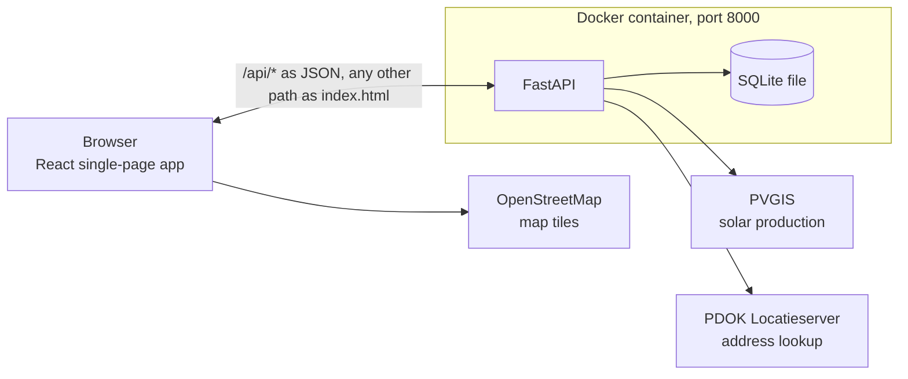
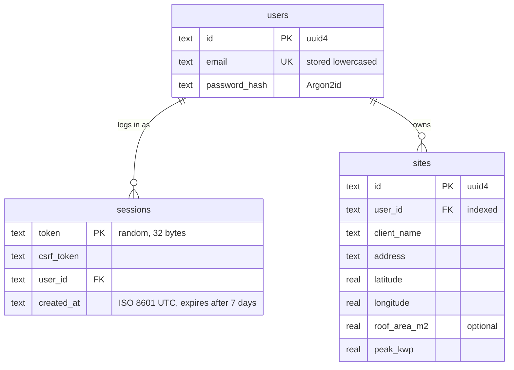

# Solar Sites

A small web app for energy advisors. An advisor registers, logs in, keeps a list of client sites, and sees for each site the estimated solar production per month and per year from PVGIS, plus how much of that production the client would use themselves with and without a home battery.

## Run it

### With Docker

```bash
docker build -t solar .
docker run -p 8000:8000 solar
```

Open http://localhost:8000 and register an account. Nothing is seeded.

The database is a SQLite file inside the container, so a new container starts empty. To keep it between containers: `docker run -p 8000:8000 -v solar-data:/backend/data solar`.

### In development

Two terminals. Python 3.14 and Node 24.

```bash
# terminal 1: backend on :8000, interactive API docs at http://localhost:8000/docs
cd backend
python -m venv .venv && source .venv/bin/activate
pip install -r requirements-dev.txt
uvicorn app.main:app --reload --port 8000

# terminal 2: frontend on :5173, /api proxied to :8000
cd frontend
npm install
npm run dev
```

Checks:

```bash
cd backend && pytest -q && ruff check . && ruff format --check .
cd frontend && npm run lint && npm run build
```

## Tech Stack

| Layer       | Choice                                                 | Why                                                                                                                                                          |
| ----------- | ------------------------------------------------------ | ------------------------------------------------------------------------------------------------------------------------------------------------------------ |
| Frontend    | Vite, React 19, TypeScript, React Router 7, Tailwind 4 | The whole interface is one page that runs in the browser. It is built once into plain files, and the Python server hands those out, so only one server runs. |
| Backend     | FastAPI with Pydantic v2                               | Every route declares the shape of the data it expects and returns. FastAPI checks incoming data against that shape and writes the API documentation itself.  |
| Database    | SQLite through Python's built-in `sqlite3`             | The database is one file on disk, with no separate database server to run. The SQL is written by hand, so every query can be read exactly as it runs.        |
| HTTP client | httpx                                                  | Makes the calls to PVGIS and PDOK, each with a time limit so a slow upstream cannot hang a request forever.                                                  |
| Passwords   | argon2-cffi                                            | Stores passwords as Argon2id hashes, the current recommendation. The password itself is never stored.                                                        |
| Tests       | pytest                                                 | Each test runs against a fresh temporary database and never touches the network.                                                                             |

How the pieces fit:



## Database

Three tables. Every session and every site belongs to one user, and a site is only ever read through its owner's id.



## API

The routes and field names are those of the brief's contract. Status codes:

| Route                            | Success                              | Failure                                                                                 |
| -------------------------------- | ------------------------------------ | --------------------------------------------------------------------------------------- |
| `POST /api/register`             | 201 `{email, csrfToken}` + cookie    | 409 email exists, 422 invalid email or password                                         |
| `POST /api/login`                | 200 `{email, csrfToken}` + cookie    | 401 wrong email or password, one message for both                                       |
| `POST /api/logout`               | 204, cookie cleared                  | 401 no session, 403 missing or wrong CSRF header                                        |
| `GET /api/me`                    | 200 `{email, csrfToken}`             | 401                                                                                     |
| `GET /api/sites`                 | 200 `[site]`                         | 401                                                                                     |
| `POST /api/sites`                | 201 site                             | 401, 403 CSRF, 422 per field                                                            |
| `GET /api/sites/{id}`            | 200 site                             | 401, 404 unknown or not the caller's                                                    |
| `PUT /api/sites/{id}`            | 200 site                             | 401, 403, 404, 422 per field                                                            |
| `DELETE /api/sites/{id}`         | 204                                  | 401, 403, 404                                                                           |
| `GET /api/sites/{id}/production` | 200 `{yearlyKwh, monthlyKwh}`        | 401, 404, 422 PVGIS has no data for the location, 502 any other PVGIS failure           |
| `GET /api/sites/{id}/battery`    | 200, shape below                     | 401, 404, 422 bad query or no data, 502                                                 |
| `GET /api/address-lookup`        | 200 `{address, latitude, longitude}` | 401, 422 malformed postcode or house number or no address found, 502 lookup unavailable |

### Why these codes

- 404 for another advisor's site, so the answer does not reveal that the id exists
- 422 for anything well-formed but not acceptable, including a location PVGIS has no data for
- 403 when the session is valid but the CSRF header is missing
- 502 for any upstream failure, timeouts included

Errors are `{"detail": "..."}` with a message, or for validation a list of `{loc, msg}` entries, one per invalid field, which the frontend shows under that field. A small handler strips the submitted value from that list, so a rejected password is never echoed. Ids are random UUIDs as strings.

The battery response fills the contract's "…" with `gridImportKwh` and `gridExportKwh` beside `selfUsedKwh`, and adds `capacityKwh` and `batteryGainKwh` at the top level.

## Sessions and security

1. Login checks the password against its Argon2id hash. A wrong email and a wrong password give the same 401.
2. A random session token and a random CSRF token are stored in a `sessions` row, and every login creates a new one.
3. The session token travels as a cookie: `HttpOnly`, `SameSite=Lax`, `Path=/`, seven-day `Max-Age`. No `Secure` flag, because the app runs on plain http at localhost.
4. The CSRF token travels in the JSON as `csrfToken`, stays in the frontend's memory, and must come back as `X-CSRF-Token` on every POST, PUT and DELETE. The server compares it in constant time, and a missing or wrong header is a 403.
5. Every request looks the session up, and a row older than seven days counts as no session. Logout deletes the row and clears the cookie.

Why a cookie plus a CSRF token rather than a bearer token: the `HttpOnly` cookie is out of reach of injected scripts, the header stops other sites from riding on the cookie, and a server-side row can be revoked at any time.

- **Passwords:** 8 to 128 characters with a capital, a digit and a symbol. A product choice, since NIST and OWASP favour length over composition rules.
- **Input:** every value reaches SQLite through a `?` placeholder, and coordinates, capacities, postcode and house number are validated before any upstream call.

## PVGIS

- All calls go through the backend. `PVcalc` gives the yearly and monthly totals, `seriescalc` the 8760 hourly values of 2023 for the battery estimate, both with the same loss and panel-angle settings.
- Results are cached in memory, so a second view of a site is instant. Timeout 30 s.
- The production card shows 5341 kWh for The Hague at 5 kWp, PVcalc's average over 2005 to 2023. The battery card shows 5338, the 2023 hourly sum, so that its own numbers add up.

## Consumption and battery model

PVGIS provides no consumption data, so the household's use is an assumption, as the brief allows. The choice:

**Daily profile.** Consumption follows PVGIS's own [default household profile](https://re.jrc.ec.europa.eu/pvg_download/hourconsumption_norm.csv): 24 hourly shares of a day's use that sum to 1, low at night and highest in the evening. Daily use is the annual use entered by the advisor divided by 365, the same every day. PVGIS hours are UTC and the profile is in local standard time, so profile hour = UTC hour + 1.

Why this profile: it is published by the same source as the production data, so nothing is invented. A flat profile would overstate self-consumption, because it puts as much use at noon as at 8 pm. And the evening peak is exactly when a battery matters. The form's default of 3500 kWh is about the Dutch household average.

**Battery, simulated hour by hour over 2023.**

- Production covers use: the house uses its share directly, the surplus charges the battery up to its free space, the rest is exported.
- Use exceeds production: the house uses all the production, the battery delivers the shortfall up to 90 % of its charge, and its charge drops by delivered ÷ 0.9. The rest is imported.
- Round-trip efficiency 90 %, applied entirely on discharge, as a general assumption from typical published figures for home batteries (see References). The battery starts empty on 1 January, has no reserve, no power limit (a 2.5 kW limit changes the year by about 1 kWh) and no ageing.
- `batteryGainKwh` is self-used with the battery minus self-used without. For The Hague, 5 kWp, 3500 kWh a year: about 1011 kWh self-used without a battery, 2312 with 5 kWh, 2774 with 10 kWh.

What it ignores, on purpose: differences between households, weekends and seasons in the load shape, summer time, and weather other than 2023's. The profile is a residential one. For a business site a feasibility study would use metered consumption instead.

## Beyond the brief

- **Address lookup.** Advisors rarely know coordinates. A postcode and house number go to `GET /api/address-lookup`, which asks the Dutch [PDOK Locatieserver](https://www.pdok.nl/introductie/-/article/pdok-locatieserver) from the backend and fills in the address, latitude and longitude, all still editable. No match is a 422, a PDOK failure a 502.
- **Map.** The sites page shows a pin per site on [OpenStreetMap](https://www.openstreetmap.org/) tiles, drawn with [Leaflet](https://leafletjs.com/).

## Known limits

- The app runs as one server process with its database in a single file inside the container. That is right for a demo and wrong for a real deployment, and the data goes with the container unless a volume is mounted.
- Expired session rows are ignored but never deleted. If a session expires while a page is open, the page shows "Not logged in" until the advisor logs out and in again.
- The backend reads a few known keys from the PVGIS answer. If PVGIS ever answered 200 with a different structure, for example after a format change, reading those keys would fail and the client would get a 500 rather than a clear 502. Checking the shape of the upstream body was left out because the API is versioned (`v5_3` in the URL) and its format is stable.

## Layout

```
Dockerfile              two stages, see "Run it"
backend/app/
  main.py               app, routers, the validation-error handler, static serving
  db.py                 schema creation, one connection per request
  schemas.py            Pydantic models, camelCase aliases, validation ranges
  auth.py               hashing, session creation and lookup, CSRF check
  pvgis.py  pdok.py     the two upstream clients
  energy.py             hourly use profile and battery simulation, pure functions
  routers/              auth, sites, address, health: validate, authorise, call a module, return a schema
backend/tests/          pytest, a temporary database per test, saved PVGIS responses in fixtures/
frontend/src/
  api/                  the only files that call fetch, types mirror the contract
  auth/                 session state, the hook, and the route guard
  sites/                site page sections: facts, production chart, battery form and result, lookup, map
  components/           design system: Button, Field, PageHeader, ErrorBanner, EmptyState, Spinner, NavBar
  pages/                Login, Register, Sites, SiteForm, SiteDetail
  index.css             Tailwind import and the design tokens
docs/                   brief, plan, stack notes, git workflow, Python primer
CLAUDE.md               working agreement and decision log for the AI assistant
```

## AI usage

I used Claude Code throughout this project as a tutor, pair programmer and reviewer. It explained Python, FastAPI, SQL and HTTP sessions to me, proposed code and the reasoning behind it, reviewed my changes against the brief and a security checklist, and ran the test and lint commands. I wrote the code with its help and reviewed every line before committing the code. The working agreement I used with it, including the decision log, is committed as `CLAUDE.md` and `docs/`.

## References

Battery round-trip efficiency (the 90 % assumption, full-size home batteries cluster around 82 to 92 %):

- Tesla Powerwall 2 AC datasheet, 90 % AC to AC at 25 °C: https://digitalassets.tesla.com/tesla-contents/image/upload/powerwall-2-ac-datasheet-en-na_001
- Zonneplan, "round-trip efficiency tot 90 %": https://www.zonneplan.nl/thuisbatterij/alles-over-thuisbatterijen
- Sessy, about 88 % at full load (pv magazine, 2022): https://pv-magazine.com/2022/07/08/new-residential-battery-from-the-netherlands
- sonnenBatterie 10 performance datasheet, about 92 % combined: https://shop.krannich-solar.com/en-de/product-downloads/0164253/sonnenBatterie-10-performance-10p-44/Datasheet-EN.pdf
- Test-Achats on datasheet figures being measured in ideal lab conditions: https://www.test-achats.be/maison-energie/energie-renouvelable/news/batterie-plug-and-play-homewizard

Consumption profile:

- PVGIS default household profile, 24 hourly shares summing to 1, local standard time: https://re.jrc.ec.europa.eu/pvg_download/hourconsumption_norm.csv
- PVGIS API documentation: https://joint-research-centre.ec.europa.eu/photovoltaic-geographical-information-system-pvgis/getting-started-pvgis/api-non-interactive-service_en

Dutch household electricity use (the 3500 kWh form default):

- ANWB, average use per household size: https://www.anwb.nl/energie/energieverbruik
- Gaslicht, ACM and CBS figures: https://www.gaslicht.com/nieuws/hoe-hoog-is-mijn-energieverbruik
